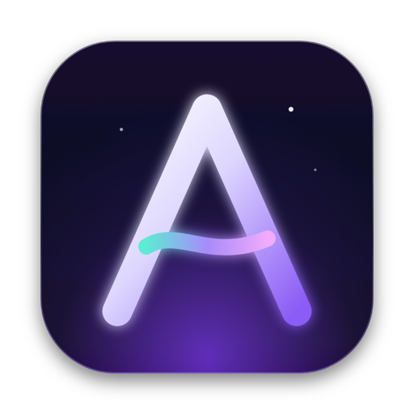
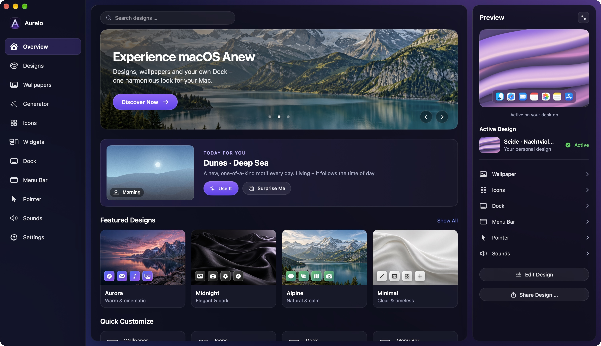
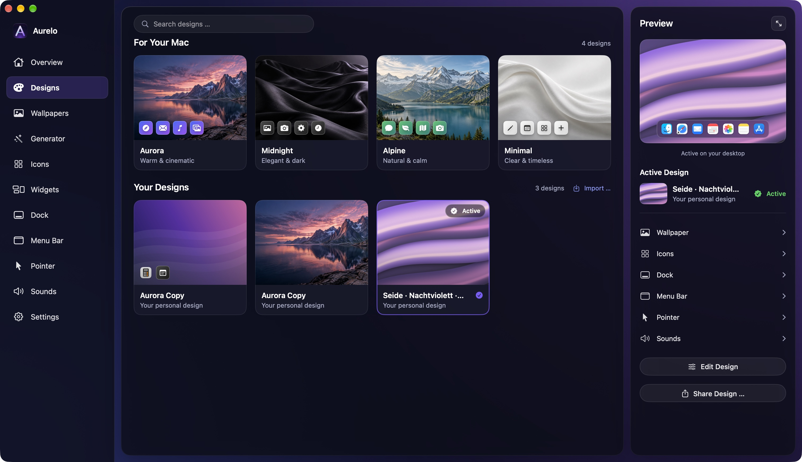
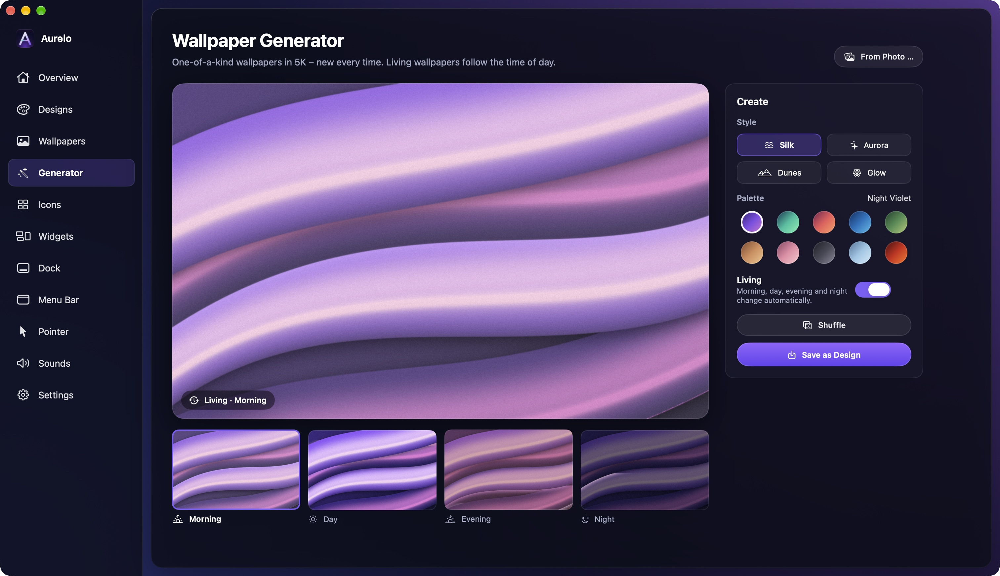
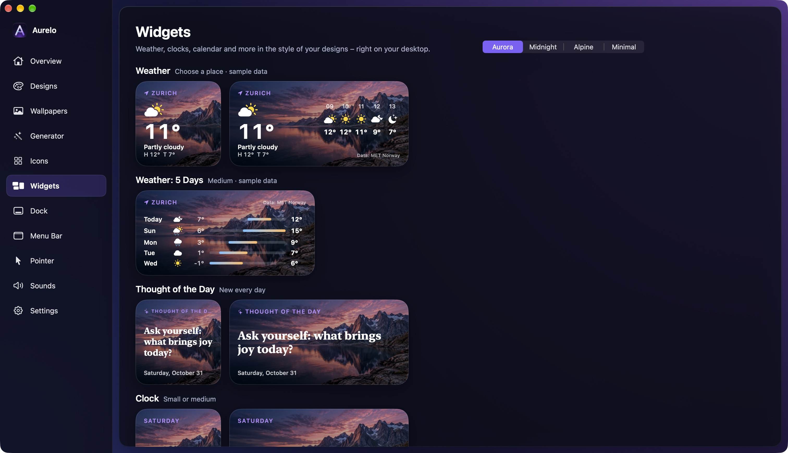

  

<h1 align="center">Aurelo</h1>

  <strong>Your Mac. Your Look.</strong> 
  Wallpaper, Dock, widgets and colors: one click to one harmonious look for your Mac.

  <a href="https://aurelo-mac.netlify.app/en/?ref=github"><strong>Website</strong></a> ·
  <a href="https://aurelo-mac.netlify.app/en/?ref=github#notify"><strong>Join the waitlist</strong></a> ·
  <a href="../../issues/new/choose"><strong>Suggest a feature</strong></a>

> **Status:** in development, made by a solo developer in Switzerland. The beta goes to the waitlist first.
> This repository is the public home for feedback, feature ideas and bug reports. The app's source code is not public.

## What Aurelo does

| | |
|---|---|
| 🎨 **Designs in one click** | Wallpaper, Dock style and colors that belong together. Applied instantly, undoable anytime. |
| ✨ **Wallpapers in 5K** | A generator for one-of-a-kind motifs. Living wallpapers follow the time of day. |
| 📸 **Design from a photo** | Your vacation shot or favorite place: Aurelo reads the colors and builds a whole look from them. |
| 🧱 **Your own Dock** | An optional Studio Dock with your apps, icon styles and position. Apple's Dock stays unchanged. |
| 🌤️ **15 widgets** | Weather, clocks, calendar, moon, countdown and more, in the style of your design. |
| ⏰ **Switch automatically** | Designs change by time of day or with your Focus mode. |

## Screenshots

| Designs | Wallpaper generator |
|---|---|
|  |  |

| Widgets |
|---|
|  |

## Safe by design

- **Everything undoable.** Every change is verified and can be restored.
- **No system hacks.** Only official macOS features, no private frameworks, no modified system files.
- **Stays on your Mac.** No account, no tracking. Your designs and photos never leave your Mac.

## Pricing

Try free for 14 days with every feature, then **CHF 29.90 once**. No subscription.

## Requirements

macOS 14.6 Sonoma or later.

## Feedback

Ideas, wishes and bugs are very welcome: [open an issue](../../issues/new/choose).
Please check the existing issues first and give a 👍 to the ideas you like, so the most wanted features get built first.
